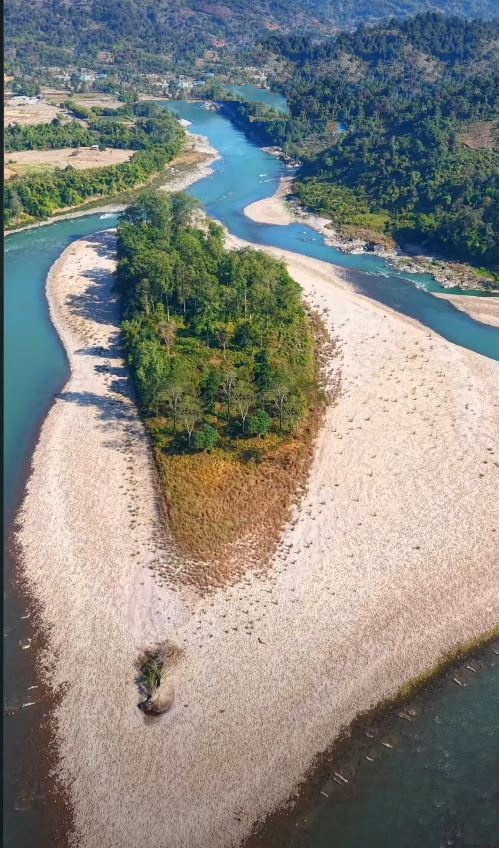
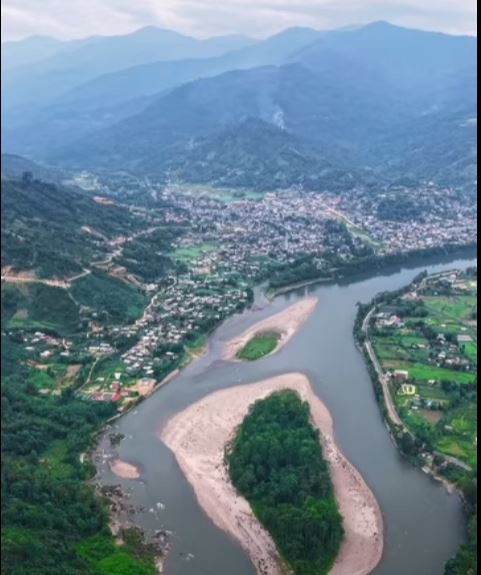

# 🏝️ Dugi Island · *Dugi Bokpen*

**A river island on the Subansiri (*Syinik*) River — ancestral land of the Dugi people**

-1e88a8?style=for-the-badge)

---

### 👋 About

**Dugi Island**, locally known as ***Dugi Bokpen***, is a river island situated on the **Subansiri River** (locally known as ***Syinik***) at **Dugi Village (Kuporijo)** under **Gusar Circle** in **Upper Subansiri District, Arunachal Pradesh, India**.

---

### 📍 Geography & Location

| | |
|:--|:--|
| 🏷️ **Official / English Name** | Dugi Island |
| 🗣️ **Indigenous / Local Name** | *Dugi Bokpen* |
| 🌊 **River System** | Subansiri River (*Syinik*) |
| 🏡 **Village / Locality** | Dugi Village (Kuporijo) |
| 🏛️ **Administrative Circle** | Gusar Circle |
| 🗺️ **District & State** | Upper Subansiri District, Arunachal Pradesh, India |
| 🛣️ **Accessibility** | Located along the corridor between the district headquarters of **Daporijo** and the administrative center of **Dumporijo** |

---

### 🪶 Indigenous Heritage & Customary Ownership

*Dugi Bokpen* (Dugi Island) is the ancestral land of the indigenous **Dugi people**, belonging to the **Dugi sub-clan** of the **Reri (*Rvrw*) clan** of the **Tagin tribe** of Upper Subansiri District.

> [!NOTE]
> Under traditional Tagin customary law, the island's territorial stewardship and ancestral rights are held collectively by its native lineages: the **Dugi, Dulom, Lida, Ridi, Dujom, and Rikar** lineages of the **Reri (*Rvrw*) clan**, together with the **Sikom, Gusar, and Bui** lineages of the **Tani-Tator sub-clan**.

<b>Reri (<i>Rvrw</i>) clan</b>

<b>Tani-Tator sub-clan</b>

---

### 🐃 Traditional & Cultural Significance

- **Mithun Rearing Ground:** For generations, *Dugi Bokpen* has served as a natural grazing and rearing ground for *mithuns* (*Bos frontalis*) owned by the indigenous Dugi people.
- **Customary Fishing Campsite:** The island functions as a traditional seasonal camping and resting site for local fishermen from **Dugi**, **Lida**, **Gusar**, **Ridi**, and **Sikom** villages.

---

### 📸 Gallery

<table>
  <tr>
    <td align="center"></td>
    <td align="center"></td>
  </tr>
  <tr>
    <td align="center">The Subansiri River valley</td>
    <td align="center">Dugi Bokpen from above</td>
  </tr>
</table>

---

🌿 Dugi Bokpen · Subansiri (<i>Syinik</i>) River · Upper Subansiri, Arunachal Pradesh 🌿

